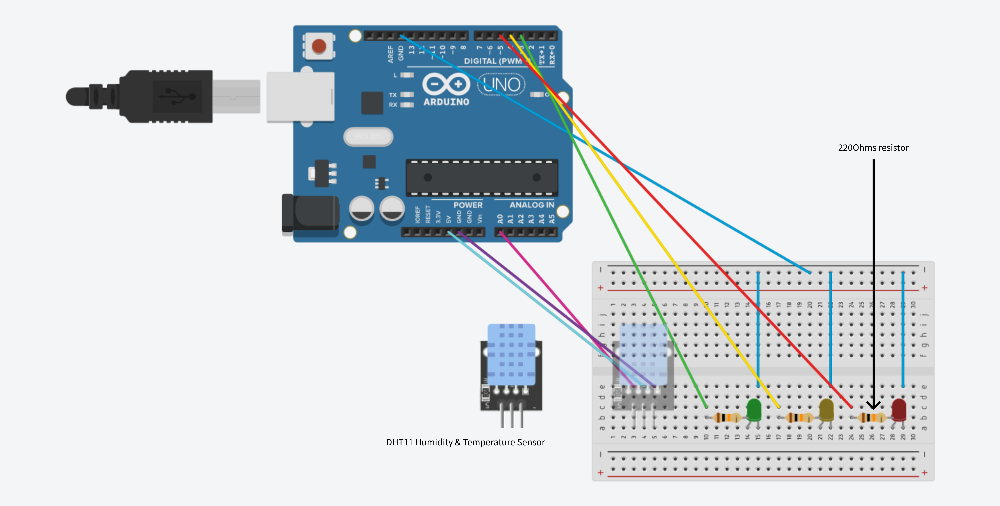

# Arduino Climate Monitor

A microcontroller-based environmental monitoring station that tracks room temperature and humidity using a DHT11 sensor and provides real-time visual feedback via a 3-LED light status system.

## Components Used
* Arduino Uno (3rd party)
* DHT11 Temperature & Humidity Sensor Module
* 3x LEDs (Green, Yellow, Red)
* 3x Resistors (220Ohms)
* Breadboard and jumper wires

## Circuit Diagram

## Code Overview
The Arduino script reads temperature and humidity data from the DHT11 sensor every two seconds. It evaluates the humidity levels against predefined safety thresholds and dynamically switches between the green, yellow, and red LEDs to indicate air quality status.

## References
- [Circuit Basics: Controlling LEDs with Arduino](https://www.circuitbasics.com/arduino-basics-controlling-led/)
- [Arduino Project Hub: Using DHT11](https://projecthub.arduino.cc/arcaegecengiz/using-dht11-12f621)
